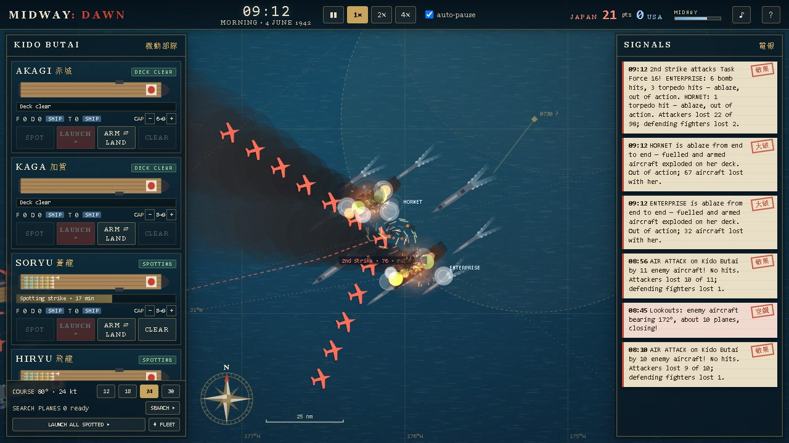
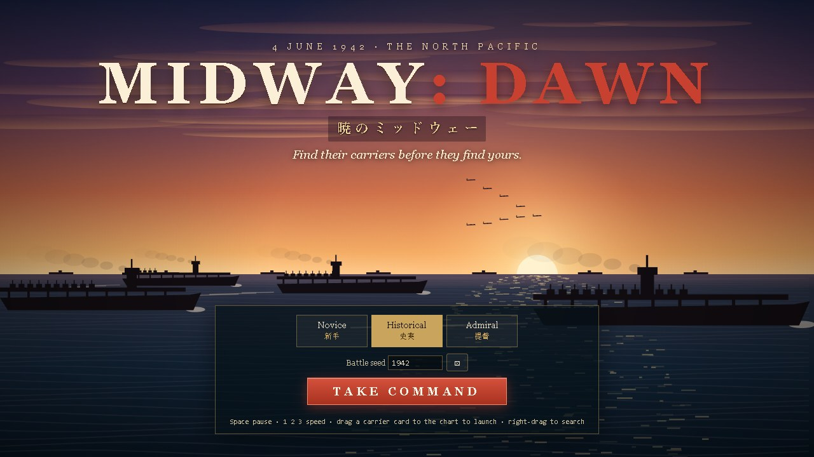
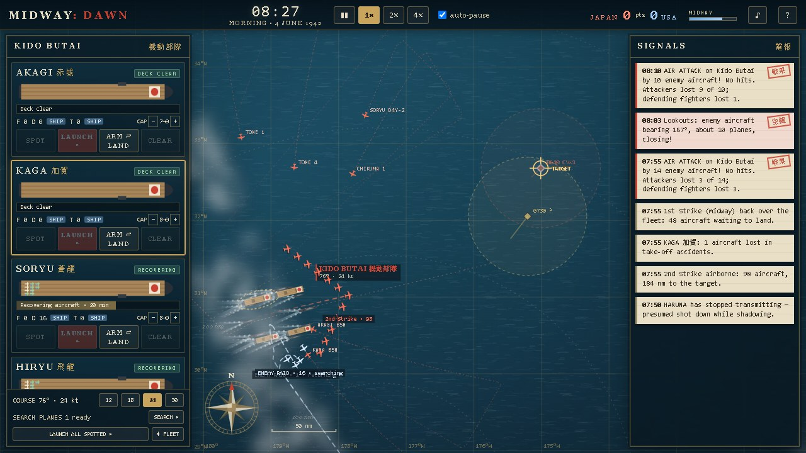
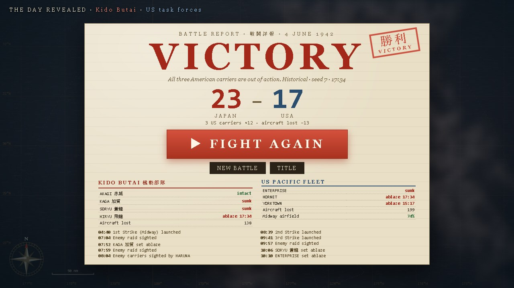

# MIDWAY: DAWN

[](https://make.fun/c/best-game-01)
[](https://make.fun/c/best-game-01)
[](https://make.fun/c/best-game-01)

An entry for make.fun's **[Make the best game](https://make.fun/c/best-game-01)** bounty (best-game-01).

**4 June 1942, dawn. You command Kido Butai — four carriers somewhere north-west of Midway. Find the American
carriers in the fog before they find you, and strike first.**



MIDWAY: DAWN is a real-time, pausable carrier battle that plays in one sitting (10–15 minutes). Its heart is the
flight deck: every strike has to be brought up and ranged on deck (35–55 minutes), launched (10), recovered (45)
and rearmed (75) — and a bomb that lands while fuelled, armed aircraft crowd the deck is far more likely to be
fatal. Meanwhile the enemy is only ever where your search planes *said* he was: their telegrams arrive late, put
him 5–35 miles off, and sometimes call carriers "cruisers".

| Title | Strike under way | Battle report |
|---|---|---|
|  |  |  |

## Play

Open `game/index.html` in desktop Chrome — it is plain static files with no build step and no network request
(double-clicking the file works; any static file server works too).

**Goal:** put all three American carriers out of action, or lead on points at sunset (18:30).
**You lose** if all four of your carriers are lost, or trail on points at sunset.
**Points:** 12 per enemy carrier put out of action, 4 per carrier damaged, 6 for Midway's airfield in ruins,
−1 per 10 of your aircraft lost (never below zero). The Americans score the same way against you.

| Do this | How |
|---|---|
| Launch a strike | Drag a glowing carrier card onto the chart (snap to a sighting diamond or to Midway), or LAUNCH ▸ then click; **L** launches every spotted deck together |
| Ready a strike | **SPOT** on a card (or select a card and press **S**) |
| Change ordnance | **ARM ⇄ TORP / LAND** (**R**): torpedoes and AP bombs for ships, land bombs for Midway |
| Clear the deck to land returning planes | **CLEAR** (**C**) strikes the spotted planes back down |
| Search | Right-drag from the fleet across the chart (or SEARCH ▸ then click) |
| Steer the fleet | Drag the fleet; speed buttons 12 / 18 / 24 / 30 kt |
| Fighter patrol | CAP − / + on each card |
| Time | **Space** pause (orders can be given while paused), **1 / 2 / 3** for 1× / 2× / 4×; auto-pause on news |
| Chart | Drag to pan, wheel to zoom, **F** back to the fleet, click a telegram to see it on the chart |
| Other | **Tab** next carrier, **M** sound, **H** the 4-step tutorial again, **Esc** cancel |

Difficulty: **Novice** (the Americans are slow to react), **Historical**, **Admiral** (better American search,
faster reactions). The battle seed changes the weather fronts, where the American task forces are, and every roll
of the day; the same seed and the same orders always replay the same battle.

## What is simulated

- **Flight decks** — a state machine per carrier (spot, launch, strike down, rearm, recover, CAP) with friction:
  elevator faults, take-off and landing accidents, planes that ditch while circling for a clear deck.
- **Search and fog of war** — dog-leg search lines, 0.6 chance to sight per look (less under cloud), radio
  delays, misidentification, position errors, shadowing planes that send updates until they are shot down.
- **Air combat** — combat air patrol against escorts (`max(0, CAP × coordination − 0.8 × escorts)`), American
  radar, the low torpedo attack that drags a radar-less CAP down to the waves for 30 minutes, flak, then bombs and
  torpedoes with per-type hit rates.
- **Damage** — two torpedoes or an unlucky bomb on an exposed deck set a carrier ablaze; she sinks hours later.
- **The Americans** — PBYs at dawn, TF16 then TF17 striking on the first sighting, Hornet's air group that may
  fly the wrong heading, Midway's piecemeal land-based raids, turn-aways, re-strikes and afternoon searches.
- **Weather** — two or three drifting cloud fronts with holes; the same cloud field the planes search through is
  the one drawn on the chart.

Everything is drawn with Canvas 2D in code (no image files) and every sound is synthesised with WebAudio.

## Layout

```
main.ts                   hands the game in (copies game/ and screenshots/, writes dossier.json)
vendor/makefun-game.ts    the kit's library, unchanged
game/index.html           the page; style.css its panels
game/src/app/             main.js (title, battle, debrief, loop), session.js (clock, orders, auto-pause),
                          showcase.js (the ?shot=1..4 screenshot scenes)
game/src/engine/          the deterministic simulation: rng, geometry, data, events, weather, forces, deck,
                          air, combat, damage, scouting, us-ai, autopilot, sim
game/src/view/            the chart: palette, camera, sea, clouds, ships, aircraft, effects, markers,
                          title-scene, renderer
game/src/ui/              hud, carrier-cards, telegrams, tutorial, debrief, input
game/src/audio/sound.js   WebAudio synthesis
scripts/                  simulate.mjs (100-battle balance runs), playtest.mjs (a whole battle through real
                          input in headless Chrome), shots.mjs (the screenshots), engine.mjs, cdp.mjs
```

The engine is plain classic scripts with no DOM, so the browser and Node (through `vm`) run the very same code:

```sh
node scripts/simulate.mjs 100 historical     # balance: carriers lost per side over 100 battles
node scripts/playtest.mjs                    # end-to-end play test in headless Chrome
node scripts/shots.mjs                       # re-take screenshots/ (real renders, ?shot=1..4&seed=7)
mkdir -p out && MAKEFUN_OUTPUT_DIR=out node main.ts
```

## License

[MIT](LICENSE). Ship and aircraft names are historical; the game, its code, art and sound are original.
